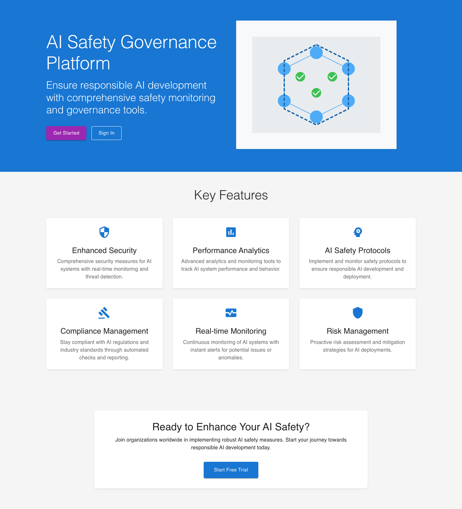
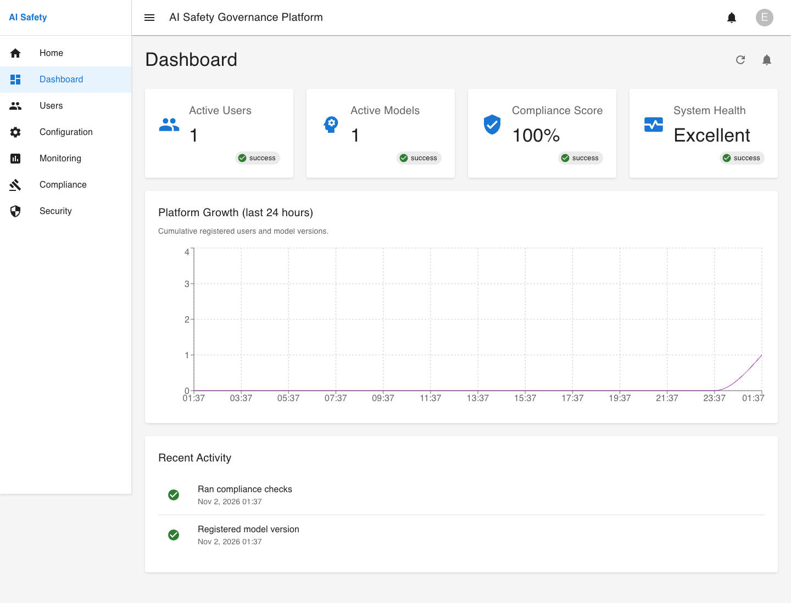
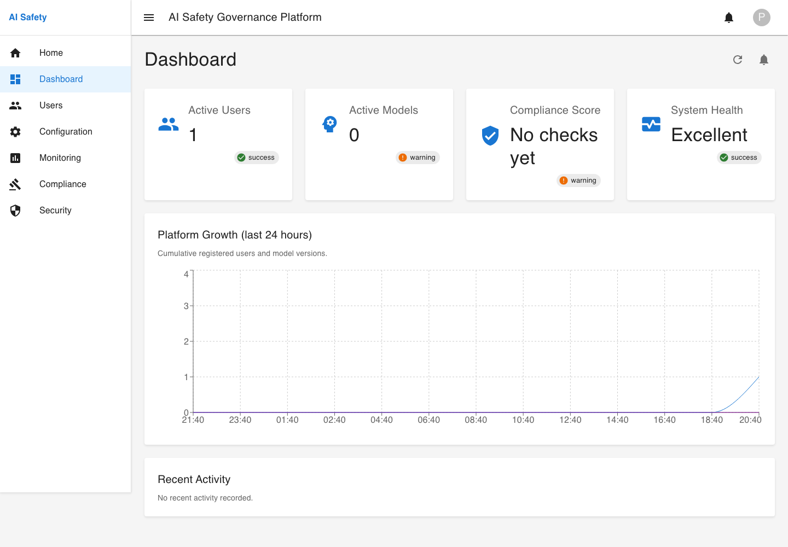
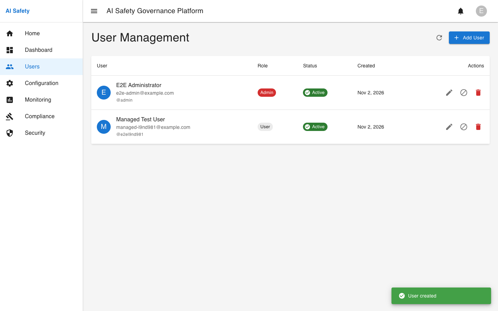
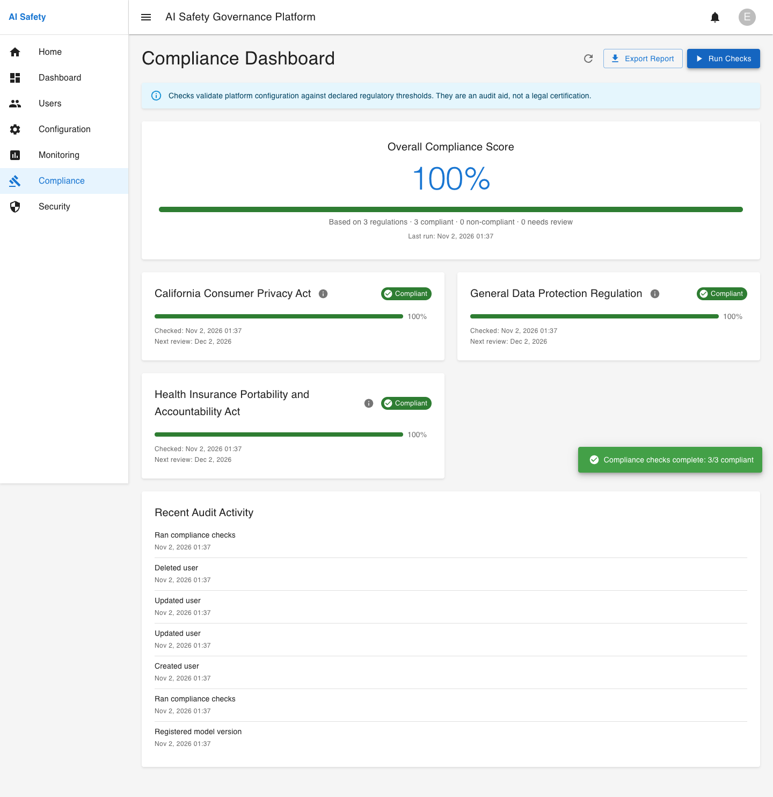
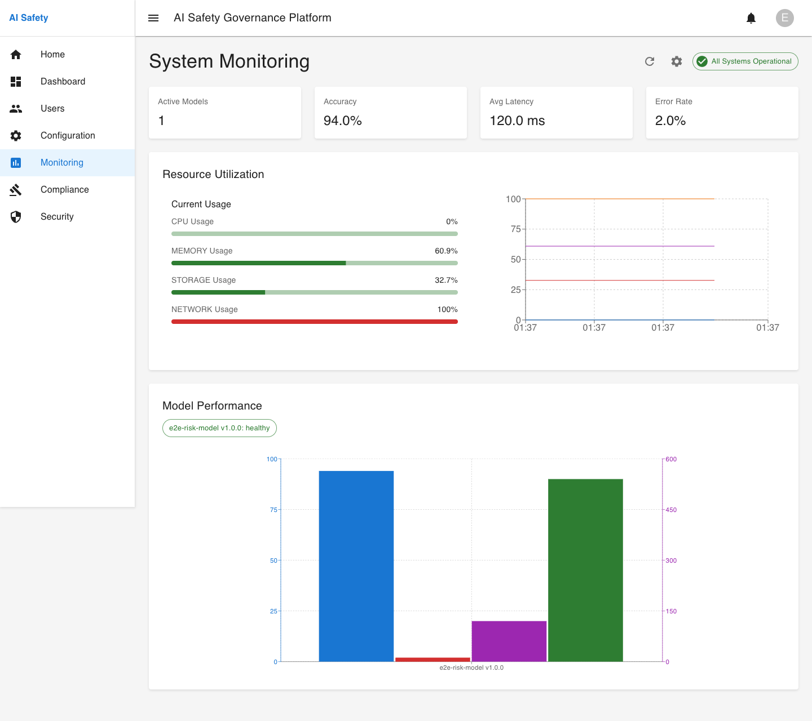
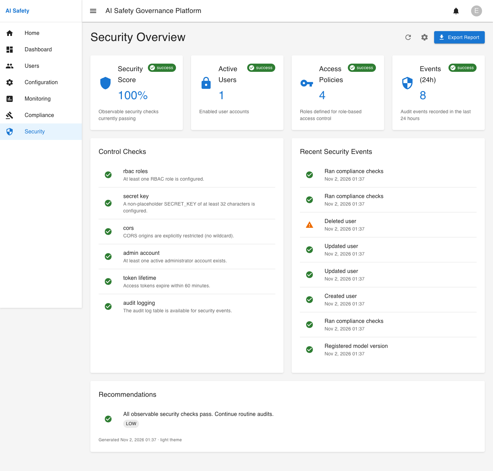
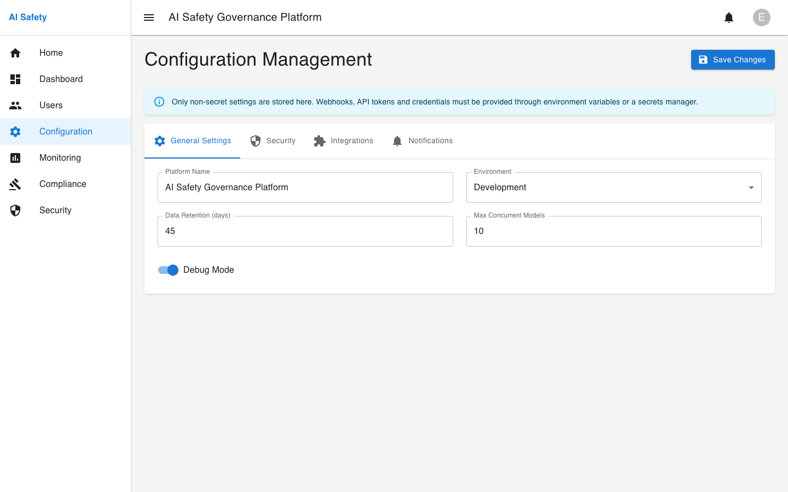
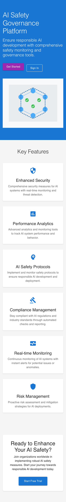
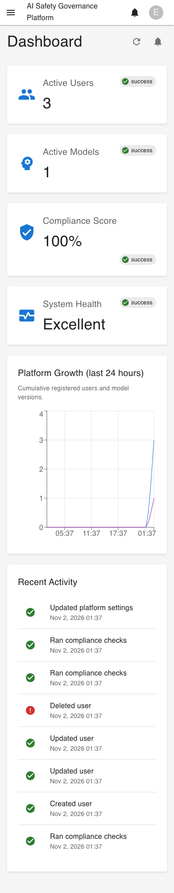

# AI Safety & Governance Platform

Full-stack reference implementation for AI model governance: a FastAPI API, a React/TypeScript dashboard, SQLite/PostgreSQL persistence, host and model monitoring, configuration-level compliance checks, security posture reporting, and Docker deployment.

[](https://www.python.org/)
[](https://nodejs.org/)
[](https://fastapi.tiangolo.com/)
[](https://react.dev/)
[](#testing-and-validation)
[](#docker-compose-verified)
[](LICENSE)

> **Verification date:** 2026-11-01. The exact commands, test counts, screenshots, and remaining risks are recorded in [`docs/evidence/verification-report.md`](docs/evidence/verification-report.md). Kubernetes manifests are static-reviewed but were **not** applied to a cluster.

---

## Overview

The platform provides a working baseline for governing AI systems:

- **Authentication and RBAC.** JWT bearer tokens, bcrypt password hashing, OAuth2 password flow, superuser scopes, and seeded admin/compliance/security/user roles.
- **User administration.** Administrators can create, edit, deactivate, delete, and password-reset users from a real API-backed UI.
- **Model registry and monitoring logs.** Register model versions, record accuracy/latency/throughput/error-rate observations, and view per-model status.
- **Live dashboard.** Aggregates active users, active models, the latest compliance score, host health, recent audit activity, and 24-hour growth series from the database.
- **Host monitoring.** Real CPU, memory, disk, and relative network activity from `psutil`; samples are persisted and charted over time.
- **Compliance checks.** Configuration-level checks for GDPR, HIPAA, and CCPA thresholds; snapshots are stored as records and written to timestamped JSON reports.
- **Security posture.** Observable checks (secret strength, CORS, admin existence, RBAC roles, token lifetime, audit logging) with recent audit events and recommendations.
- **Platform settings.** Persisted non-secret settings for general, security, integration, and notification sections.
- **Responsive UI.** Desktop and mobile layouts, responsive navigation, loading/error/empty states, and accessible labels.

### Verification at a glance

| Area | Result | Evidence |
| --- | --- | --- |
| Backend tests | **32 passed**, 80% coverage of API/core modules | [`backend-coverage.txt`](docs/evidence/test-results/backend-coverage.txt) |
| Frontend tests | **8 passed** (Jest), 72.34% line coverage of the two covered monitoring components | [`frontend-coverage.txt`](docs/evidence/test-results/frontend-coverage.txt) |
| TypeScript | `tsc -b` passes | [`frontend-build.log`](docs/evidence/build-results/frontend-build.log) |
| ESLint | passes with `--max-warnings 0` | CI workflow and local run |
| Production build | `tsc -b && vite build` passes | [`frontend-build.log`](docs/evidence/build-results/frontend-build.log) |
| Browser E2E | **14 passed** in Chromium, no console errors or failed API requests | [`e2e-run.txt`](docs/evidence/test-results/e2e-run.txt), [`playwright-results.json`](docs/evidence/test-results/playwright-results.json) |
| Docker Compose | All five services healthy; migrations, login, monitoring, and Grafana verified | [`docker-runtime-verification.txt`](docs/evidence/build-results/docker-runtime-verification.txt) |
| Production preview | Built bundle served, login works through `/api` proxy, no console/API errors | [`production-smoke.txt`](docs/evidence/build-results/production-smoke.txt) |
| Production dependency audit | `npm audit --omit=dev`: **0 vulnerabilities** after non-breaking updates | [`npm-audit.txt`](docs/evidence/test-results/npm-audit.txt) |

---

## Architecture

```
┌──────────────────────────────┐
│ Browser                      │
│ React 18 + TypeScript + MUI  │
│  /  /login  /dashboard ...   │
└──────────────┬───────────────┘
               │ HTTP (Axios)
               │ /api/* proxy in dev/preview
┌──────────────▼───────────────┐
│ FastAPI (src/main.py)        │
│ JWT auth · RBAC scopes       │
│ users · models · compliance  │
│ monitoring · dashboard       │
│ security · settings · health │
└──────┬───────────────┬───────┘
       │               │
       │ SQLAlchemy    │ psutil / report files
┌──────▼───────┐  ┌────▼─────────────────┐
│ SQLite (dev) │  │ compliance_logs/      │
│ PostgreSQL   │  │ JSON + audit logs     │
│ (Docker)     │  └───────────────────────┘
└──────────────┘
       │
┌──────▼─────────────────────────────────┐
│ Observability (Docker Compose)         │
│ Prometheus → /metrics (liveness)       │
│ Grafana    → service health (no boards)│
└────────────────────────────────────────┘
```

**Deployment topology verified in this environment:** React SPA → Vite proxy → Uvicorn/Gunicorn → SQLAlchemy → PostgreSQL 15, plus Prometheus and Grafana, all in Docker Compose.

### Technology stack

| Layer | Technology |
| --- | --- |
| Backend | Python 3.12, FastAPI, Pydantic v2, SQLAlchemy 2.x, Alembic |
| Auth | `python-jose` (HS256 JWT), `passlib` + `bcrypt` |
| Persistence | SQLite for local development/tests; PostgreSQL 15 for Docker |
| Frontend | React 18, TypeScript 5.6, Vite 6, Material UI 5, React Router 7, Axios, Recharts, date-fns |
| Testing | pytest + pytest-cov, Jest + Testing Library, Playwright |
| Operations | Docker/Compose, Gunicorn + Uvicorn worker, Prometheus, Grafana |
| CI | GitHub Actions (`.github/workflows/ci.yml`) |

### Repository layout

```
src/
├── api/
│   ├── routers/        # auth, users, models, compliance, monitoring,
│   │                   # dashboard, security, settings
│   ├── schemas.py      # Pydantic request/response models
│   ├── security.py     # JWT, password hashing, scopes, role checks
│   └── serializers.py  # Safe user serialization
├── compliance/
│   ├── checks.py       # Configuration-level regulatory rules
│   └── regulatory_alignment.py
├── database/
│   ├── __init__.py     # Engine, session, URL resolution, initialization
│   ├── bootstrap.py    # Idempotent default RBAC roles
│   ├── models.py       # SQLAlchemy models
│   └── migrations/     # Alembic environment and revisions
├── scripts/
│   └── seed_admin.py   # Admin bootstrap CLI / environment hook
├── utils/
│   └── time.py
├── frontend/
│   ├── e2e/            # Playwright specs
│   ├── src/pages/      # Landing, auth, dashboard, users, monitoring,
│   │                   # compliance, security, configuration
│   ├── src/services/   # API clients
│   └── scripts/        # Production-preview smoke test
├── main.py             # FastAPI application and lifespan
└── start.sh            # Container startup: wait for DB, migrate, Gunicorn
tests/                  # 32 API and unit tests
docs/evidence/          # Screenshots, logs, coverage, verification report
```

**Experimental/design modules:** `src/model_monitoring/`, `src/security/`, `src/documentation_generator/`, `src/gitops/`, `src/chaos_engineering/`, and `src/management_interface/` contain the original broader design and prototypes. They are **not wired into the running API**, and some require optional heavy dependencies (NumPy, pandas, scikit-learn, SHAP, LIME, boto3, Kubernetes, etc.). They are retained for roadmap work; see [Known limitations](#known-limitations).

---

## Quick start (local, SQLite)

### Prerequisites

- Python **3.12** (3.10+ should work; CI uses 3.12)
- Node.js **22+** and npm (tested with Node 26 / npm 11)
- No database server required for local development

### 1. Backend

```bash
python3 -m venv .venv
source .venv/bin/activate          # Windows: .venv\Scripts\activate
python -m pip install --upgrade pip
pip install -r requirements.txt

# Optional: create .env and set SECRET_KEY, CORS_ORIGINS, ADMIN_* values.
cp .env.example .env

# Bootstrap an administrator (or let the app do it when ADMIN_* are set).
ADMIN_EMAIL=admin@example.com \
ADMIN_PASSWORD='<a-strong-password>' \
ADMIN_USERNAME=admin \
python -m src.scripts.seed_admin

python -m uvicorn src.main:app --reload --port 8000
```

- API: <http://127.0.0.1:8000>
- Swagger/OpenAPI: <http://127.0.0.1:8000/docs>
- Health: `GET /health`; readiness: `GET /ready`

On first start the app creates the schema and stamps the current Alembic head (`DB_AUTO_INIT=true`). To apply migrations manually:

```bash
alembic upgrade head
```

If `ADMIN_EMAIL` and `ADMIN_PASSWORD` are present at startup, an administrator is created (or left unchanged) automatically. Self-registration always creates a non-superuser account.

> **Port note:** local development uses **8000** because macOS AirPlay Receiver commonly occupies port 5000. Docker uses port 5000 inside the container and publishes **5002** on the host.

### 2. Frontend

```bash
cd src/frontend
npm ci
npm run dev
```

- UI: <http://127.0.0.1:5173>
- Vite proxies `/api` to `http://127.0.0.1:8000` by default (`VITE_API_PROXY_TARGET` overrides it).
- `VITE_API_URL` can point the browser at a separately hosted API when no reverse proxy is available.

### 3. Sign in

Register a normal account in the UI, or use the administrator created above. Administrator-only pages are visible only to users with the `admin` role/superuser flag; the API enforces the same rule.

---

## Docker Compose (verified)

```bash
cp .env.example .env
# Edit .env: set a long random SECRET_KEY and ADMIN_* credentials.
# Do not commit .env.

docker compose up --build
```

| Service | URL | Notes |
| --- | --- | --- |
| Frontend (Vite) | <http://localhost:5173> | Proxies `/api` to the backend |
| Backend API | <http://localhost:5002> | `/docs`, `/health`, `/ready` |
| PostgreSQL | internal only | Not published to the host |
| Prometheus | <http://localhost:9090> | Scrapes `backend:5000/metrics` |
| Grafana | <http://localhost:3000> | Local demo login `admin`/`admin`; change it |

The stack was verified end-to-end: backend health/readiness, migrations, admin bootstrap, frontend-proxied login, Prometheus targets (`up`), Grafana health, and role seeding. See [`docker-runtime-verification.txt`](docs/evidence/build-results/docker-runtime-verification.txt).

> The Compose `SECRET_KEY` fallback is a development placeholder. The security page reports it as failing until a real secret is supplied. The PostgreSQL password and Grafana credentials are local-development defaults, not production settings.

---

## Environment configuration

Environment variables are read from the process environment; `.env` is loaded at package import for local convenience. Docker Compose also reads `.env`.

| Variable | Default | Purpose |
| --- | --- | --- |
| `SECRET_KEY` | development placeholder | JWT signing key. Use 32+ random characters in production. |
| `ACCESS_TOKEN_EXPIRE_MINUTES` | `30` | Access token lifetime. |
| `ALGORITHM` | `HS256` | JWT algorithm. |
| `DATABASE_URL` | `sqlite:///./ai_safety_governance.db` | Explicit SQLAlchemy URL. Docker uses PostgreSQL. |
| `POSTGRES_*` | — | Alternative PostgreSQL configuration when `DATABASE_URL` is unset. Uses the `psycopg2` driver. |
| `DB_AUTO_INIT` | `true` | Create/stamp a fresh schema or run pending migrations at startup. Docker sets `false` because `start.sh` migrates first. |
| `CORS_ORIGINS` | `http://localhost:5173,http://127.0.0.1:5173` | Comma-separated browser origins. Wildcards are rejected by the security posture check. |
| `ADMIN_EMAIL`, `ADMIN_PASSWORD`, `ADMIN_USERNAME`, `ADMIN_FULL_NAME` | unset | Optional administrator bootstrap at startup. |
| `COMPLIANCE_AUDIT_DIR` | `./compliance_logs` | Directory for audit logs and JSON reports. |
| `COMPLIANCE_CONFIG_PATH` | `./config/compliance_config.json` | Compliance thresholds and notification configuration. |
| `PORT`, `HOST`, `WEB_CONCURRENCY` | `8000`, `0.0.0.0`, `2` | Runtime process settings. Container start script defaults to port 5000. |
| `VITE_API_URL` | empty | Frontend API origin. Empty uses the Vite proxy. |
| `VITE_API_PROXY_TARGET` | `http://127.0.0.1:8000` | Dev/preview proxy target. Docker sets `http://backend:5000`. |

Never commit `.env`, `config/secrets.env`, database files, or generated compliance logs containing real data.

---

## API overview

All application endpoints are under `/api/v1`. Authentication uses `Authorization: Bearer <token>`.

| Area | Endpoints |
| --- | --- |
| Auth | `POST /auth/token`, `POST /auth/register`, `POST /auth/refresh-token`, `POST /auth/logout` |
| Users | `GET/PUT /users/me`, `GET/POST/PUT/DELETE /users/` (admin) |
| Models | `GET/POST/PUT/DELETE /models/versions`, `POST /models/monitoring`, `GET /models/monitoring/{version_id}` |
| Monitoring | `GET /monitoring/system`, `/monitoring/resources/{resource}`, `/monitoring/models/metrics`, `/monitoring/models/performance`, `/monitoring/performance`, `/monitoring/alerts` |
| Compliance | `POST /compliance/checks/run`, `GET /compliance/summary`, CRUD `/compliance/records`, `GET /compliance/audit-logs` |
| Dashboard | `GET /dashboard/summary` |
| Security | `GET /security/summary` (admin/security scope) |
| Settings | `GET/PUT /settings` (admin) |
| Health | `GET /health`, `GET /ready`, `GET /metrics`, `GET /docs` |

Scopes are `user`, `admin`, `models`, `compliance`, and `security`. Superusers receive all scopes; assigned roles contribute the keys in their `permissions` JSON. The default roles are `admin`, `compliance-officer`, `security-officer`, and `user`.

### Example

```bash
TOKEN=$(curl -s -X POST http://127.0.0.1:8000/api/v1/auth/token \
  -H 'Content-Type: application/x-www-form-urlencoded' \
  -d 'username=admin@example.com&password=<a-strong-password>' \
  | python -c 'import sys,json; print(json.load(sys.stdin)["access_token"])')

curl -H "Authorization: Bearer $TOKEN" http://127.0.0.1:8000/api/v1/dashboard/summary
curl -X POST -H "Authorization: Bearer $TOKEN" http://127.0.0.1:8000/api/v1/compliance/checks/run
```

---

## Testing and validation

### Commands

```bash
# Backend
.venv/bin/pytest tests/ -q
.venv/bin/pytest tests/ \
  --cov=src/api --cov=src/database --cov=src/main.py \
  --cov=src/compliance --cov=src/utils --cov-report=term-missing

# Backend lint/format (API/core)
.venv/bin/flake8 src/api src/database src/main.py src/scripts src/utils \
  src/compliance/checks.py src/compliance/regulatory_alignment.py
.venv/bin/black --check src/api src/database src/main.py src/scripts src/utils \
  src/compliance/checks.py src/compliance/regulatory_alignment.py

# Frontend
cd src/frontend
npm run lint          # ESLint, zero warnings
npm run typecheck     # tsc -b
npm test              # Jest
npm run test:coverage
npm run build         # tsc -b && vite build

# Browser E2E (starts isolated backend on 5001 + Vite on 5173)
npm run e2e
```

Playwright uses the installed Chrome channel locally and the bundled Chromium in CI (`CI=true`). It writes screenshots to `docs/evidence/screenshots` and reports to `docs/evidence/test-results`.

### Current results

- **Backend:** 32 tests passed. Coverage: **80%** of `src/api`, `src/database`, `src/main.py`, `src/compliance`, and `src/utils`. Migrations have lower coverage because they are exercised end-to-end by Docker.
- **Frontend:** 8 Jest tests passed in 2 suites; 72.34% line coverage for the two monitoring components. Page-level coverage is provided by Playwright.
- **E2E:** 14 tests passed in Chromium at 1440×900 and 390×844. Tests assert no browser console/page errors and no API responses ≥ 400. Evidence: [`playwright-results.json`](docs/evidence/test-results/playwright-results.json), [`e2e-run.txt`](docs/evidence/test-results/e2e-run.txt).
- **Build:** production bundle built successfully; preview smoke test logged in and rendered the dashboard with no console/API errors.
- **Docker:** five services healthy; see evidence above.
- **CI:** `.github/workflows/ci.yml` runs backend lint/tests/coverage, frontend lint/typecheck/tests/build, and Playwright E2E. It was not executed on GitHub from this environment; the local equivalents passed.

### Security/audit notes

- Production dependency audit: **0 vulnerabilities** (`npm audit --omit=dev`).
- Full dev-toolchain audit still reports advisories in Jest/Playwright/ESLint transitive packages; most have no non-breaking fix. See [`npm-audit-all.txt`](docs/evidence/test-results/npm-audit-all.txt).
- `pip-audit` reports 3 advisories in `python-jose`/`ecdsa`; the app uses HS256 with a symmetric secret, not ECDSA. See [`pip-audit.txt`](docs/evidence/test-results/pip-audit.txt).
- Backend dependencies are pinned to a passlib-compatible bcrypt line (`bcrypt<4.1`).

---

## Screenshots

All screenshots are captured from the running application. Full evidence is in [`docs/evidence/screenshots`](docs/evidence/screenshots).

### Landing page

[](docs/evidence/screenshots/homepage-desktop.png)

### Dashboard (local and Docker)

| Local development | Docker Compose |
| --- | --- |
| [](docs/evidence/screenshots/dashboard-desktop.png) | [](docs/evidence/screenshots/dashboard-docker.png) |

### User administration

[](docs/evidence/screenshots/users-admin.png)

### Compliance checks and exported report

[](docs/evidence/screenshots/compliance-checks.png)

### Monitoring, security, and configuration

| Monitoring | Security | Configuration |
| --- | --- | --- |
| [](docs/evidence/screenshots/monitoring-desktop.png) | [](docs/evidence/screenshots/security-desktop.png) | [](docs/evidence/screenshots/configuration-settings.png) |

### Mobile

| Landing | Dashboard |
| --- | --- |
| [](docs/evidence/screenshots/homepage-mobile.png) | [](docs/evidence/screenshots/dashboard-mobile.png) |

---

## Production build

```bash
cd src/frontend
npm ci
npm run build
```

Serve `dist/` from a web server or CDN and reverse-proxy `/api` to the backend. For a local production-bundle smoke test:

```bash
# Terminal 1: backend on 8000 (see Quick start)
# Terminal 2:
cd src/frontend
npm run preview -- --host 127.0.0.1 --port 4173
# Terminal 3:
cd src/frontend
node scripts/smoke-production.mjs
```

`vite preview` proxies `/api` to `VITE_API_PROXY_TARGET` (default `http://127.0.0.1:8000`) and is intended only for smoke testing; use a real reverse proxy in production.

### Backend process (Docker/production)

`src/start.sh` waits for the database, runs `alembic upgrade head`, and starts:

```bash
gunicorn --bind 0.0.0.0:5000 --workers 2 \
  --worker-class uvicorn.workers.UvicornWorker \
  --timeout 60 --no-control-socket src.main:app
```

The Docker image uses Python 3.12, runs as an unprivileged UID 1000 user, and exposes `/health` for health checks. Use PostgreSQL for multi-worker/production deployments; SQLite is for local development and tests.

---

## Security model

- Passwords are hashed with bcrypt; passwords must be at least 8 characters with upper/lowercase, a number, and a special character.
- JWTs are signed with `SECRET_KEY`; access tokens expire after 30 minutes by default.
- `/auth/refresh-token` re-verifies the password before issuing a new token. This endpoint previously issued tokens without password verification; a regression test covers it.
- CORS origins are explicit and configurable; credentialed requests are not allowed from wildcard origins.
- Responses include `X-Content-Type-Options`, `X-Frame-Options`, `Referrer-Policy`, `X-XSS-Protection`, and `Permissions-Policy` headers.
- Superusers receive all scopes; admin-only endpoints reject regular users with `403`.
- The settings UI stores only non-secret values; webhooks, tokens, and credentials must come from environment variables/a secrets manager.
- No secrets are required in the repository. `.env` and generated data are ignored.

**Known security gaps:** no server-side rate limiting or token denylist; JWTs are stored in `localStorage` (so an XSS bug could expose them); no Content-Security-Policy is applied by the app; MFA/IP-whitelist settings are persisted but not enforced.

---

## Known limitations

1. **Regulatory scope.** Automated checks cover **configuration-level** GDPR, HIPAA, and CCPA thresholds. EO 14110, OMB M-24-10, and NIST AI RMF are design references only; they are not automated or certified here. Compliance results are an audit aid, not legal advice.
2. **Experimental modules.** `src/model_monitoring/`, `src/security/`, `src/documentation_generator/`, `src/gitops/`, and `src/chaos_engineering/` are prototypes. They require optional dependencies and are not imported by the running API.
3. **RBAC management.** Default roles and scopes exist, but there is no UI/API to assign roles to users; superuser status is managed through the user administration screen.
4. **Notifications and MFA.** Settings flags for email/Slack notifications and MFA are stored but do not send messages or enforce MFA.
5. **Monitoring fidelity.** `network` is relative host network activity, not link saturation. Model monitoring metrics are supplied through the API; there is no automatic drift/fairness pipeline in the running app.
6. **Observability.** `/metrics` exposes a liveness gauge only; Prometheus/Grafana verify connectivity, not a complete model-performance dashboard.
7. **Kubernetes.** Manifests were statically reviewed and obvious port/API issues were fixed, but **no cluster was available** to apply them. `${ECR_REGISTRY}`, `${IMAGE_TAG}`, and `${AWS_ACCOUNT_ID}` must be substituted; configure database egress, secrets, and image pull credentials for the target cluster.
8. **CI execution.** The GitHub Actions workflow is committed; it was validated through the equivalent local commands, not by a GitHub-hosted run from this environment.
9. **Dependency advisories.** Production npm dependencies audit clean; dev-toolchain and Python advisories remain (see Security/audit notes).
10. **Database tests.** pytest uses SQLite. PostgreSQL compatibility was verified through the Docker stack, but there is no separate PostgreSQL test matrix.

---

## Documentation

- [Verification report](docs/evidence/verification-report.md)
- [Usage guide](docs/usage.md)
- [Architecture](docs/architecture.md)
- [Deployment guide](DEPLOYMENT.md)
- [Security policy](docs/security_policy.md)
- [Evidence index](docs/evidence)
- [Changelog](CHANGELOG.md)

---

## Author

**Donnivis Baker** — [github.com/dbsectrainer](https://github.com/dbsectrainer)
**BE EASY ENTERPRISES** — Federal IT Modernization & Cybersecurity

## License

MIT — see [LICENSE](LICENSE).
